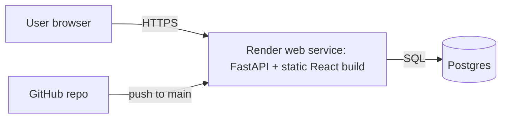
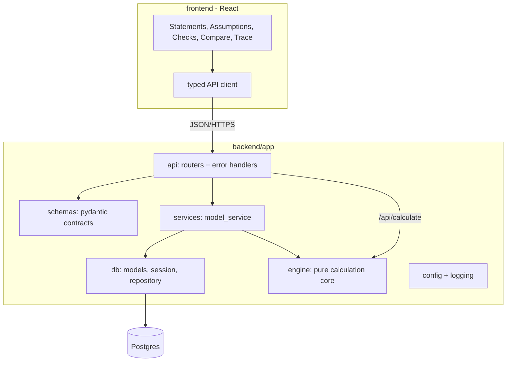
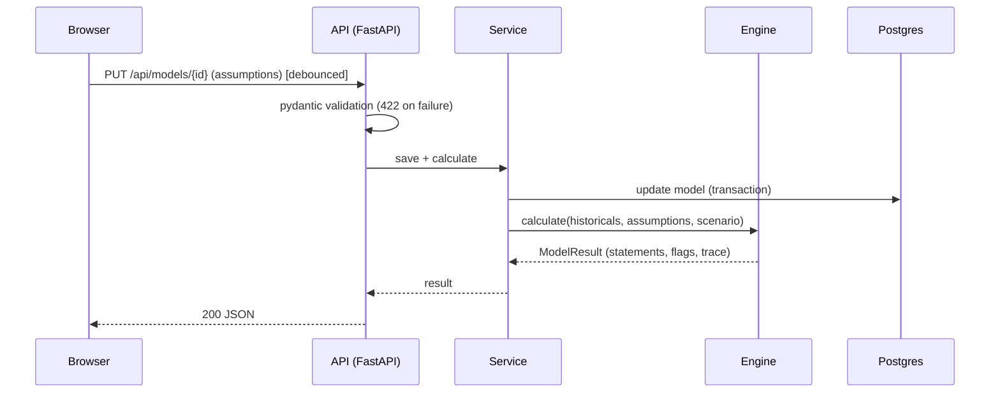
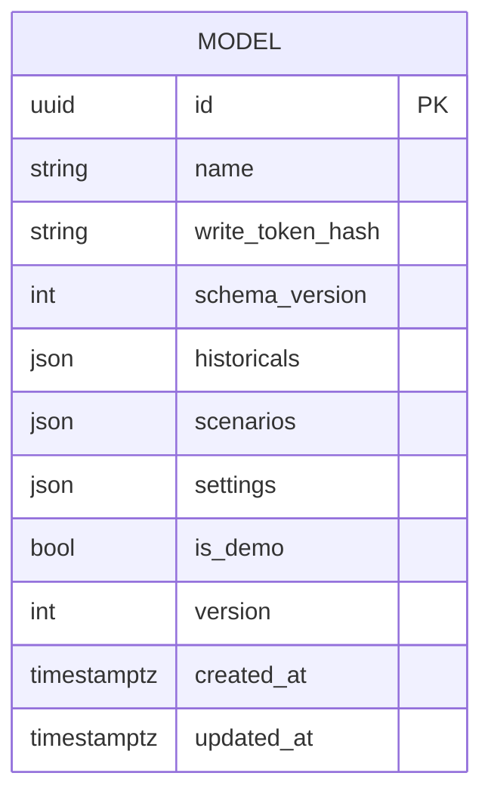
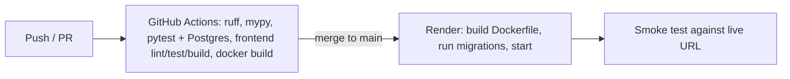

# TriadModel — Architecture

> Status: design baseline, revision 2 (backend added). Nothing here is claimed as working until the checklist in [docs/REQUIREMENTS.md](docs/REQUIREMENTS.md) marks it verified. Requirement IDs (F*, N*, B*) refer to that file.

## 1. Purpose and boundaries

TriadModel turns historical income statement, balance sheet and cash flow data into a fully linked multi-year forecast. Users edit assumptions in Base / Upside / Downside scenarios, the three statements recompute, and the system flags broken accounting relationships and cash shortfalls.

**Inside:** calculation engine, REST API, persistence of saved models, web UI, import/export, validation.
**Outside:** accounting-system integrations, user accounts/SSO, market data, multi-entity consolidation.



## 2. Architecture style and justification

A **single deployable modular monolith**: one FastAPI service that exposes a JSON API *and* serves the compiled React app. One Render service, one database.

- **Why a backend now:** saved models and scenarios survive across browsers and devices, shareable by link; the engine runs server-side with exact `Decimal` arithmetic; the API makes the engine usable by scripts/other tools.
- **Why one service, not two:** the frontend is static files. Serving them from FastAPI removes CORS, a second deployment and a second free-tier quota.
- **Why a pure engine package:** the calculation is the part that must be correct. It has no web, DB or I/O imports, so it is exhaustively unit-testable.
- **Why a small explicit dependency graph:** each forecast line declares its inputs. One mechanism yields calculation order, cycle detection (F13) and the trace view (F14). It is deliberately minimal, not a spreadsheet engine.
- **Why Python:** `Decimal` gives exact currency arithmetic; strong typing with pydantic v2 + mypy; first-class testing; natural fit for finance tooling.

Not used: microservices, queues, caches, GraphQL, ORMs beyond SQLAlchemy, accounts/OAuth (see §9).

## 3. Technology choices

| Concern | Choice | Reason |
|---|---|---|
| Backend | Python 3.12+ (dev on 3.13), FastAPI, Uvicorn | Typed, auto-validated, OpenAPI for free |
| Validation/schemas | Pydantic v2 | Request/response contracts and engine input types |
| Persistence | SQLAlchemy 2 + Alembic; Postgres (prod), SQLite (local/unit tests) | Migrations required; Postgres available on Render. Integration tests also run against real Postgres in CI |
| Frontend | React + TypeScript + Vite, built to static files | Instant, reactive assumption editing |
| Backend tests | pytest, httpx TestClient, pytest-cov, Hypothesis (property tests) | Standard; Hypothesis suits "BS balances for all valid inputs" |
| Frontend tests | Vitest + Testing Library; Playwright (+axe) for E2E | |
| Quality | Ruff (lint+format), mypy --strict, ESLint, Prettier, pip-audit, npm audit | |
| Packaging/deploy | Multi-stage Dockerfile → Render (Docker runtime) | Node builds the UI, Python runs the app; identical locally and on Render |
| CI | GitHub Actions | Repo is on GitHub |

Dependencies are pinned in `requirements.txt` (runtime) / `requirements-dev.txt` and `frontend/package-lock.json`.

## 4. Component architecture



**Dependency rule:** `engine` imports only the standard library (and its own types). `services` may import `engine` and `db`. `api` imports `services` and `schemas`. Nothing imports `api`. Checked in CI with an import-linter-style test.

### Responsibilities

- **engine/** — `types` (line items, assumptions, result, flags), `graph` (nodes keyed `line@period`, topological evaluation, `CycleError`), `forecast/` (revenue, opex, working_capital, ppe, debt, tax, equity), `statements` (assemble IS/BS/CF), `checks` (integrity and liquidity flags), `scenarios` (scenario resolution), `calculate` (entry point).
- **schemas/** — API contracts; the *only* place untrusted input becomes typed objects. Historical balance sheets must balance; percentages bounded; years contiguous.
- **services/** — orchestrates: validate → persist → calculate. Contains no HTTP and no SQL.
- **db/** — SQLAlchemy models, session handling, repository functions; Alembic migrations in `backend/migrations`.
- **api/** — thin routers, consistent error envelope, health endpoints.

## 5. Calculation model (core)

Per forecast period *t*, in dependency order. All amounts are `Decimal`.

1. Revenue(t) = Revenue(t−1) × (1 + growth)
2. COGS = Revenue × COGS%; SG&A = Revenue × SG&A%
3. Capex = Revenue × capex%; Depreciation = opening net PP&E × depreciation rate; PP&E = opening + capex − depreciation
4. AR = Revenue × DSO/365; Inventory = COGS × DIO/365; AP = COGS × DPO/365; other working-capital items held flat
5. Interest = opening term loan × rate + opening revolver × rate − opening cash × cash yield (opening balances ⇒ no circularity; assumption A3)
6. EBT = Revenue − COGS − SG&A − Depreciation − net interest; Tax = max(0, EBT) × tax rate; NI = EBT − Tax
7. Dividends = max(0, NI) × payout ratio
8. Term loan repayment = min(opening balance, scheduled amount)
9. Cash before revolver = opening cash + NI + depreciation − ΔNWC − capex − term repayment − dividends
10. Revolver: if cash before revolver < minimum cash, draw the gap up to the limit; if above, repay min(opening revolver, surplus).
11. If the gap exceeds the revolver capacity the draw is capped and a **`REVOLVER_LIMIT_EXCEEDED`** flag is raised; the model never invents funding.
12. RE = opening RE + NI − dividends; common stock flat.
13. BS totals are *computed*; cash on the BS is taken from the cash flow statement's ending cash. The accounting identity A = L + E is **checked, never forced**.

Constants (days per year = 365, default tolerance) are named in `engine/constants.py`. Decimal context precision is set explicitly in one place.

### Flags

| Code | Severity | Condition |
|---|---|---|
| `BS_IMBALANCE` | error | \|assets − (liabilities + equity)\| > tolerance |
| `CASH_TIE_OUT` | error | CF ending cash ≠ BS cash |
| `NI_TIE_OUT` | error | IS net income ≠ CF starting net income |
| `RE_ROLLFORWARD`, `PPE_ROLLFORWARD`, `DEBT_ROLLFORWARD` | error | opening + movements ≠ closing |
| `CASH_BELOW_MINIMUM` | warning | ending cash < minimum cash |
| `REVOLVER_LIMIT_EXCEEDED` | error | funding need > revolver capacity |
| `NEGATIVE_CASH` | error | ending cash < 0 |
| `NEGATIVE_EQUITY` | warning | total equity < 0 |

Rejected at the API boundary rather than flagged: unbalanced historical balance sheet (HTTP 422 naming the year and the difference).

Integrity flags should not fire on correct engine output; tests inject faults to prove each one triggers (AC3), and property tests assert they never fire on valid random inputs.

## 6. Data flow



For "what-if" edits that should not be saved, `POST /api/calculate` is stateless: same engine, no DB.

## 7. Database

Intentionally small. One aggregate: a saved model, stored as validated JSON documents (historicals and per-scenario assumptions are always read and written together; there is no cross-model querying, so normalising into many tables would add cost without benefit).



- `id`: UUIDv4 (unguessable); `write_token_hash`: SHA-256 of a random token returned once at creation; constant-time comparison on write.
- `version`: optimistic concurrency. Updates send `If-Match`/`version`; a stale version → HTTP 409.
- Indexes: primary key only; no list endpoint exists (see §9), so no further index is justified.
- Constraints: NOT NULL on all columns, `version >= 1`, `schema_version` checked in application and by migration.
- Alembic migrations are the only way schema changes; CI runs `alembic upgrade head` on empty Postgres and a downgrade/upgrade round trip.

## 8. API contract (summary; full detail goes to docs/API.md once implemented)

| Method & path | Purpose |
|---|---|
| `GET /health/live`, `GET /health/ready` | Liveness; readiness (DB reachable) |
| `POST /api/calculate` | Stateless calculation of a posted model |
| `POST /api/models` | Create saved model → `{id, write_token, model}` |
| `GET /api/models/{id}` | Fetch model + calculated result |
| `PUT /api/models/{id}` | Update (requires `X-Write-Token`, `version`); returns new result |
| `DELETE /api/models/{id}` | Delete (requires token) |
| `GET /api/models/{id}/export?format=json\|csv` | Export |
| `GET /api/demo` | Demo company input (labelled `is_demo: true`) |

Errors use one envelope: `{"error": {"code": "...", "message": "...", "details": [...]}}` with codes such as `VALIDATION_ERROR` (422), `NOT_FOUND` (404), `FORBIDDEN` (403), `VERSION_CONFLICT` (409), `PAYLOAD_TOO_LARGE` (413), `RATE_LIMITED` (429), `INTERNAL_ERROR` (500, generic message, details only in logs). Financial problems are never errors: they come back as `flags` in a 200 result.

## 9. Security

- **Authentication decision (assumption A6):** no user accounts in MVP. Access uses capability tokens: possession of the model UUID grants read (share link); possession of the write token grants write/delete. There is **no list/search endpoint**, so models cannot be enumerated. Trade-off: anyone with the link can read; losing the write token loses edit rights. Documented in SECURITY.md. Full accounts are a future option if the owner wants private multi-user workspaces.
- Input validation by pydantic at every endpoint; request size cap (default 1 MB); bounded array lengths (≤ 15 periods).
- SQL only via SQLAlchemy parameterised statements.
- Rate limiting on write and calculate endpoints (in-process limiter, adequate for a single instance; documented as per-instance).
- Security headers (CSP, `X-Content-Type-Options`, `Referrer-Policy`, HSTS in production), no wildcard CORS (same origin by design; allowlist configurable for local dev).
- CSV export neutralises leading `= + - @` in text cells.
- No secrets in the repo; `DATABASE_URL` and other settings from environment, validated at startup with an actionable error.
- Logs never contain write tokens or full payloads.
- `pip-audit` and `npm audit` in CI; Dependabot configured.
- Tests for: token required/incorrect → 403, no enumeration, oversize payload, malformed JSON, header presence, rate limit.

## 10. Configuration

Pydantic Settings reads environment variables; validated on startup. Documented in `.env.example`:

| Variable | Purpose | Default |
|---|---|---|
| `DATABASE_URL` | SQLAlchemy URL (Postgres in prod; SQLite file locally) | `sqlite:///./triadmodel.db` (dev only) |
| `APP_ENV` | `development` / `production` (enables HSTS, disables docs if chosen) | `development` |
| `LOG_LEVEL` | Logging level | `INFO` |
| `MAX_REQUEST_BYTES` | Body size cap | `1048576` |
| `CORS_ALLOWED_ORIGINS` | Comma list; empty = same-origin only | empty |
| `RATE_LIMIT_PER_MINUTE` | Per-client write/calc limit | `60` |
| `PORT` | Provided by Render | `8000` |

## 11. Logging, errors, monitoring

Structured JSON logs to stdout (Render collects them), with a request ID per request. Expected errors map to the envelope; unexpected exceptions are logged with stack trace and return generic `INTERNAL_ERROR`. Readiness endpoint checks DB connectivity. No external error-monitoring service until justified.

## 12. Performance

The engine works on ~40 lines × ≤ 15 periods; pure CPU, microseconds–milliseconds. The plan is to *measure* `calculate` on the demo model and API latency locally, and report only measured figures. The UI debounces edits (≈250 ms) before calling the API. Known operational factor: Render's free web tier spins down when idle and has a cold start of up to about a minute (to be verified at deploy time); the UI shows a clear "waking server" state rather than failing.

## 13. Reliability and data integrity

- Engine is deterministic and side-effect free; JSON round-trip yields identical results (AC5).
- Writes occur in a single transaction with optimistic locking; concurrency test with two stale writers asserts exactly one wins.
- Postgres on Render: backup/retention depends on the plan; free-tier databases have expiry limits that must be checked at deploy time and documented in DEPLOYMENT.md (not assumed here).
- Graceful shutdown via Uvicorn on SIGTERM; DB pool pre-ping and bounded timeouts.

## 14. Testing strategy

| Layer | Tool | Focus |
|---|---|---|
| Unit (engine) | pytest | Each forecast module against hand-computed values; graph order, cycle detection; each flag via injected faults; boundary cases (zero revenue, zero debt, all-negative income) |
| Property | Hypothesis | For random *valid* assumptions in all scenarios: BS balances, cash ties, roll-forwards hold, deterministic |
| Schema/validation | pytest | Valid/invalid/boundary payloads, unbalanced history |
| Integration | pytest + real Postgres (CI service container; SQLite locally) | Repository, transactions, optimistic-lock conflict, migrations up/down |
| API/contract | pytest + TestClient | Status codes, schemas, error envelope, token auth, size limit, headers, rate limit |
| Frontend unit/component | Vitest + Testing Library | Editing assumption updates statements; flags rendered as text |
| E2E | Playwright | Load demo → edit growth → statements change → save → reload via link; downside shortfall flag; invalid import error; axe scan |
| Smoke | script | Run against deployed URL: health, demo calc, create/read model |

Coverage: pytest-cov; target ≥ 90% statements on `engine` and `schemas`/`services`, ≥ 80% overall backend. Coverage is a signal, not proof.

## 15. Deployment



- `Dockerfile` (multi-stage): stage 1 builds the frontend with Node; stage 2 installs Python deps, copies backend and `dist/`, runs as non-root user.
- `render.yaml` (Blueprint) declares the web service and the Postgres database, injecting `DATABASE_URL`.
- Start command runs `alembic upgrade head` then Uvicorn. Health check path: `/health/ready`.
- Rollback: redeploy the previous Render deploy/commit; migrations are written backward-compatible for one release so a code rollback does not require a DB rollback.
- **Manual steps for the owner** (cannot be done by me): create the GitHub repo and push; connect it to Render and apply the Blueprint; confirm the plan. Deployment is "done" only after the live URL passes the smoke test.

## 16. Proposed repository structure

```
TriadModel/
├── architecture.md  README.md  CONTRIBUTING.md  CHANGELOG.md  SECURITY.md
├── .env.example  .gitignore  .dockerignore  Dockerfile  render.yaml
├── .github/workflows/ci.yml
├── pyproject.toml            # ruff, mypy, pytest, coverage config
├── requirements.txt  requirements-dev.txt
├── alembic.ini
├── docs/  REQUIREMENTS.md SETUP.md API.md TESTING.md DEPLOYMENT.md  DECISIONS/ADR-00x-*.md
├── backend/
│   ├── app/
│   │   ├── main.py            # app factory, middleware, static mount
│   │   ├── config.py  logging.py
│   │   ├── api/               # routers: health, calculate, models; errors.py
│   │   ├── schemas/           # pydantic contracts
│   │   ├── services/          # model_service.py
│   │   ├── db/                # models.py, session.py, repository.py
│   │   ├── data/demo.py       # demo company (labelled)
│   │   └── engine/            # pure core (types, graph, forecast/, statements, checks, scenarios, calculate)
│   ├── migrations/            # alembic
│   └── tests/ unit/ property/ integration/ api/ fixtures/
├── frontend/                  # Vite + React + TS (src/, tests/, e2e/)
└── scripts/smoke_test.py
```

## 17. Key decisions and trade-offs

| Decision | Alternative | Trade-off accepted |
|---|---|---|
| Python/FastAPI monolith serving the SPA | Separate Node API + static site | Two toolchains in one image (handled by multi-stage Docker) in exchange for one service and no CORS |
| `Decimal` engine | Floats | Slower (irrelevant at this scale), exact currency math; division still needs a tolerance |
| Capability-token access, no accounts | Full auth | Weaker privacy model (link = read access); far less scope and attack surface; documented |
| Model stored as JSON document | Normalised statement tables | Cannot query across models/lines in SQL; none of the workflows need to |
| Opening-balance interest | Average balance + iteration | Slightly less precise; deterministic, no circularity |
| Revolver cap + shortfall flag | Unlimited auto-funding | Honest "unfunded" outputs |
| Cash from CF; BS balance *checked* | Cash as plug | Bugs surface instead of being hidden |
| Docker on Render | Native Python runtime | Slightly slower builds; needs Node for the UI build and gives local/prod parity |
| In-process rate limiter | Redis | Per-instance only; acceptable for a single instance |

## 18. Known limitations and future work

No tax-loss carry-forward, leases, deferred taxes, equity issuance or non-annual periods. Free-tier hosting has cold starts and possible database limits (to verify). Future: user accounts with private workspaces, average-balance interest with bounded iteration, sensitivity tables, covenant flags, PDF export.
